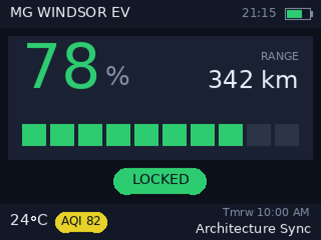
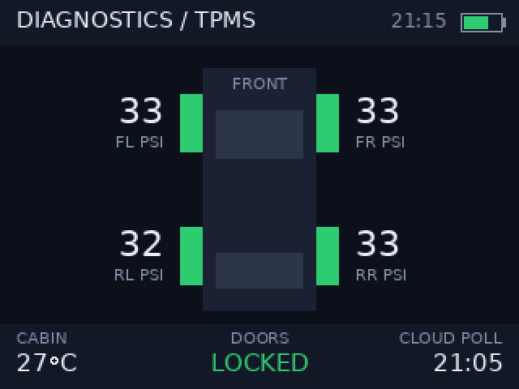
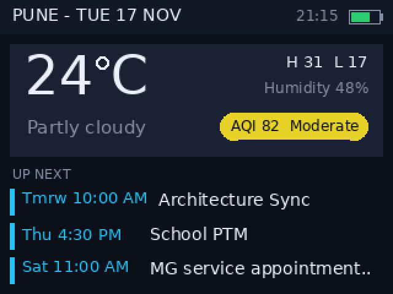
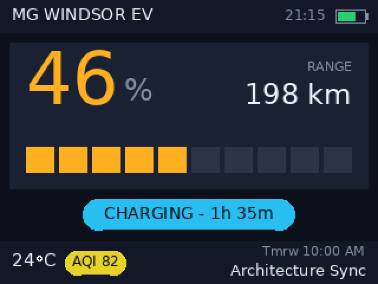
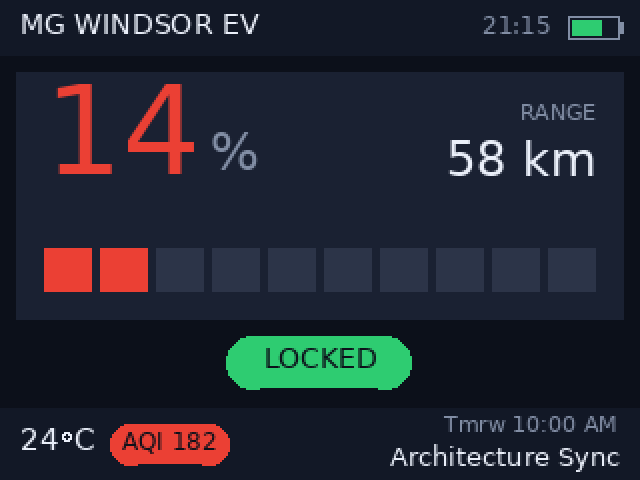
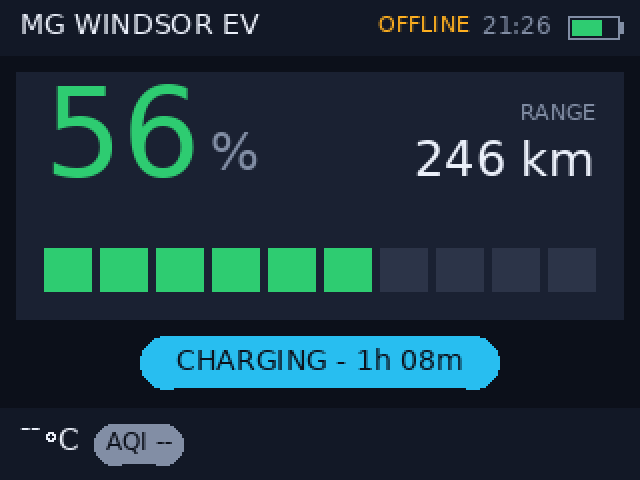

# Windsor Glance — MG Windsor EV & Home Telemetry Display

A Pimoroni **Tufty 2350** (Badgeware) desk/nightstand display for the **MG Windsor EV**, with
Pune weather/AQI and your next calendar events. Built from SRS v1.0.

| Glance | TPMS | Weather & schedule |
|---|---|---|
|  |  |  |
|  |  |  |

*Rendered by `tools/simulator.py` with the PC fallback font. On the badge the vector font is
MonaSans, so spacing will differ a little.*

```
MG cloud / Home Assistant ─┐
Open-Meteo (weather + AQI) ├─► Tier 1: bridge/  (FastAPI, caches, rate-limits)  ──HTTP LAN──►  Tier 2: badge/windsor_glance  (Badgeware app)
Google Calendar (ICS)     ─┘        GET /api/v1/glance  (X-Badge-Key, < 1 KB JSON)
```

## Repo layout

```
bridge/                     Tier 1 — local telemetry bridge (Python 3.11+)
  windsor_bridge/app.py       FastAPI app, background pollers, /api/v1/glance
  windsor_bridge/vehicle.py   providers: mock | homeassistant | saic (experimental)
  windsor_bridge/weather.py   Open-Meteo forecast + US AQI
  windsor_bridge/calendar_feed.py  ICS feed with recurring events expanded
  windsor_bridge/dump.py      print raw + normalised vehicle data (verify mappings)
  run_bridge.py, .env.example, Dockerfile, docker-compose.yml, deploy/, tests/
badge/
  windsor_glance/__init__.py  Tier 2 — the badge app (single file)
  windsor_glance/icon.png     24×24 launcher icon
  secrets_example.py          lines to add to the badge's secrets.py
tools/simulator.py          runs the badge app on a PC (Pillow) and saves screenshots
```

## 1. Choose how the bridge reads the car

| `VEHICLE_PROVIDER` | Use when | Notes |
|---|---|---|
| `homeassistant` **(recommended)** | You run Home Assistant with an MG/SAIC integration | HA owns cloud polling, so set the 12 V-safe scan interval in the integration. The bridge re-reads HA every 2 min, which costs nothing. Map entity IDs in `.env`. |
| `saic` | Direct cloud access with the **secondary** MG account | **Experimental for India.** It uses `saic-ismart-client-ng`, which targets SAIC's EU/AU iSMART endpoints. JSW MG India's endpoint/region/tenant are not publicly documented, so you'll need to supply `SAIC_BASE_URI/REGION/TENANT_ID`, then check the field mapping with `python -m windsor_bridge.dump`. Adaptive polling (45 min parked, 15 min only while charging) applies here. |
| `mock` | Development and the Phase 4 tests | `MOCK_SCENARIO=auto|parked|charging|unlocked|lowbatt|lowtyre` |

## 2. Run the bridge

Windows (PowerShell, in `bridge\`):
```powershell
py -3.12 -m venv .venv; .venv\Scripts\pip install -r requirements.txt
copy .env.example .env   # set BADGE_API_KEY, BIND_HOST=<laptop LAN IP>, provider settings
.venv\Scripts\python run_bridge.py
# auto-start at logon + private-network firewall rule:
powershell -ExecutionPolicy Bypass -File deploy\install-windows-task.ps1
```
Linux / Raspberry Pi: `python3 -m venv .venv && .venv/bin/pip install -r requirements.txt`, then use `deploy/windsor-bridge.service`.
Docker: `docker compose up -d` (edit the LAN IP in `docker-compose.yml`).

Verify:
```bash
curl -H "X-Badge-Key: <key>" http://192.168.1.50:8000/api/v1/glance
curl -H "X-Badge-Key: <key>" http://192.168.1.50:8000/api/v1/debug   # errors, next poll time, payload size
```
Reserve the host's IP in your router's DHCP so it doesn't change. Run tests with `pip install pytest && pytest -q tests`.

## 3. Install on the Tufty

1. Plug the badge in over USB-C and **double-tap RESET**. It mounts as the `TUFTY` drive.
2. Copy `badge/windsor_glance/` into `apps/` on the drive.
3. Open the existing `secrets.py` on the drive and add the four lines from `badge/secrets_example.py`.
4. Eject, reset, and pick **Windsor Glance** from the menu.

**Controls:** **A** sync now · **B** TPMS (press again to go back) · **C** weather & schedule (again to go back) · **UP/DOWN** brightness 25/50/80/100 %/AUTO, saved between sessions.

**Power:** On battery, the screen stays on 20 s after wake, a button press or unplugging, then Wi-Fi goes off and the badge sleeps for 30 min with `badge.sleep(1800)`. On USB, it never sleeps and refreshes every 15 min.

## Where this differs from the SRS (and why)

- **Badgeware, not PicoGraphics.** Retail Badgeware firmware uses its own `screen`/`badge`/`wifi` API (badgewa.re/docs), so the app is written against that API.
- **Icon is 24×24** (Badgeware requirement), not 64×64. The app is one `__init__.py`, because Badgeware launches `__init__.py`. Config goes in the badge's existing `secrets.py` (the file `wifi.connect()` reads), not a separate file. Mount via **double-tap RESET**.
- **Rear LEDs are single-colour white** per the Badgeware docs. Charging is a slow breathe. Unlocked or SoC < 20 % gives 3 sharp pulses after a sync. Red and green appear on screen instead.
- **Backlight:** the docs don't list a backlight call. The app tries `display.backlight()` / `badge.backlight()` and otherwise dims in software. Software dimming doesn't save power.
- **Cache** is `/windsor_glance.json` (the root is the only volume apps can write at runtime). It also stores your brightness setting.
- **AQI** is Open-Meteo's US AQI scale, not India's NAQI.
- **Payload extras:** `date`, `sod`, `ev.polled_at`, `weather.aqi_cat/humidity/hi/lo`, and `events[]` (up to 3). The payload stays under 1 KB, which is enforced by a test.

## Things to check on the real hardware

1. **After a 30-min sleep, does the badge relaunch the app or return to the menu?** `badge.sleep()` resets the badge on wake. If it lands on the menu, set Windsor Glance as the boot app in your firmware's launcher config.
2. **Battery life (NFR-1).** One wake takes about 3–6 s with Wi-Fi plus 20 s of screen time. Measure real drain over 24 h. If it falls short of 4 days, lower `AWAKE_MS`.
3. Run the SRS Phase 4 checklist using `MOCK_SCENARIO=unlocked`/`charging`, and stop the bridge for the offline test.
